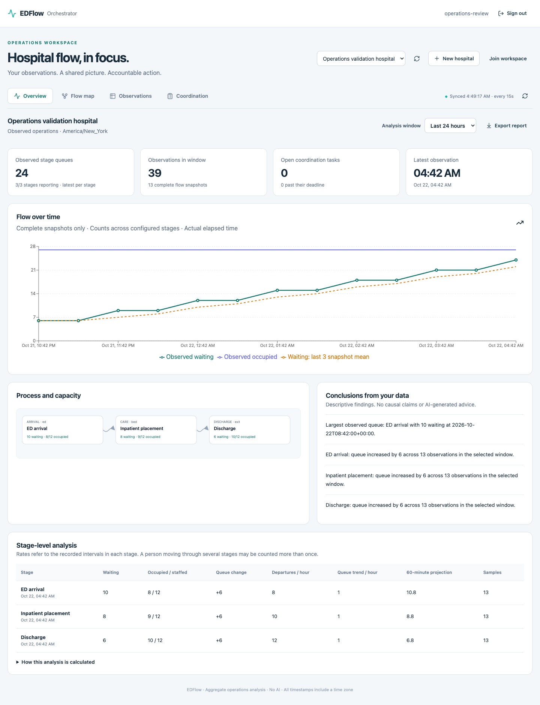
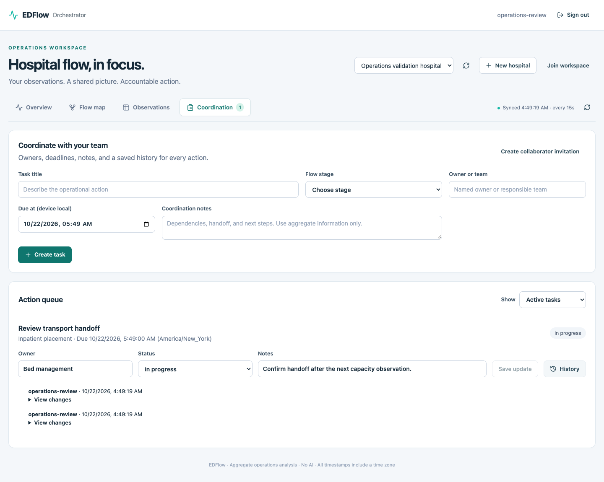
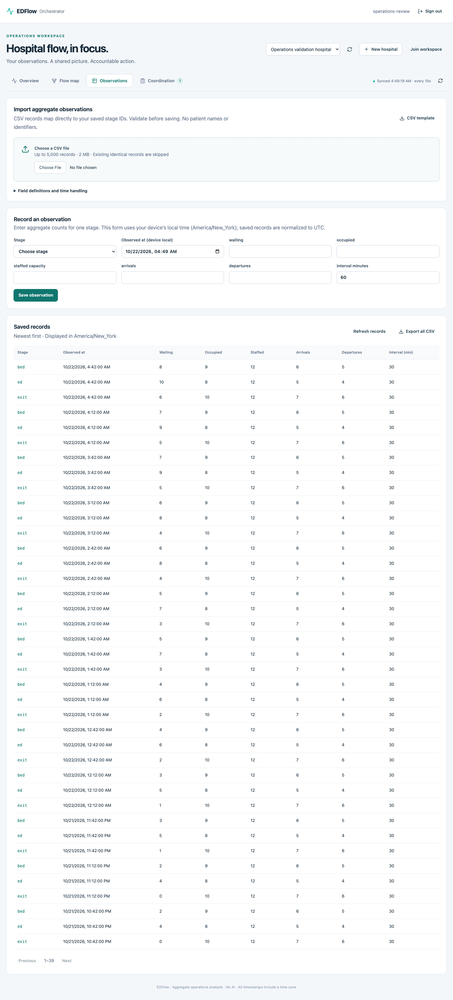

# EDFlow Orchestrator

I built EDFlow to connect hospital process maps, operational time-series analysis, and team coordination in one workspace.

Users can create hospital workspaces, define stages and connections, import aggregate observations, and track actions with owners, deadlines, notes, and history. The app calculates queue changes, interval throughput, rolling averages, and clearly labeled linear trend projections from the supplied data. It uses **no AI**.

## Features

- Editable hospital flow maps with JSON import/export
- CSV import with validation, duplicate detection, and timezone-aware timestamps
- Live workspace refresh every 15 seconds, historical date filters, and exported analysis
- Shared tasks, single-use collaborator invitations, and persistent audit history
- Account-scoped access and PostgreSQL storage; no sample-data fallback

Flow imports use structured JSON; observation imports use the CSV template available in the app. EDFlow accepts aggregate operational counts, not patient records. Its findings describe the submitted data; trend projections are not validated forecasts.

## Run locally

```bash
docker compose up --build
```

Open [EDFlow](http://localhost:5173) and create an account. Create a hospital, save its flow, then add observations or import a CSV. View API documentation at [localhost:8000/docs](http://localhost:8000/docs).

For development without Docker, see [setup and deployment](docs/deployment.md). The stack is React, TypeScript, Tailwind CSS, Recharts, FastAPI, and SQLAlchemy.

## Screenshots

Overview:



Coordination:



Observations:



## Checks

```bash
python -m pytest
npm ci --prefix frontend
npm test --prefix frontend
npm run build --prefix frontend
```

The repository also retains the original CMS ingestion pipelines and research notebooks. They are separate from the live hospital workspace.
